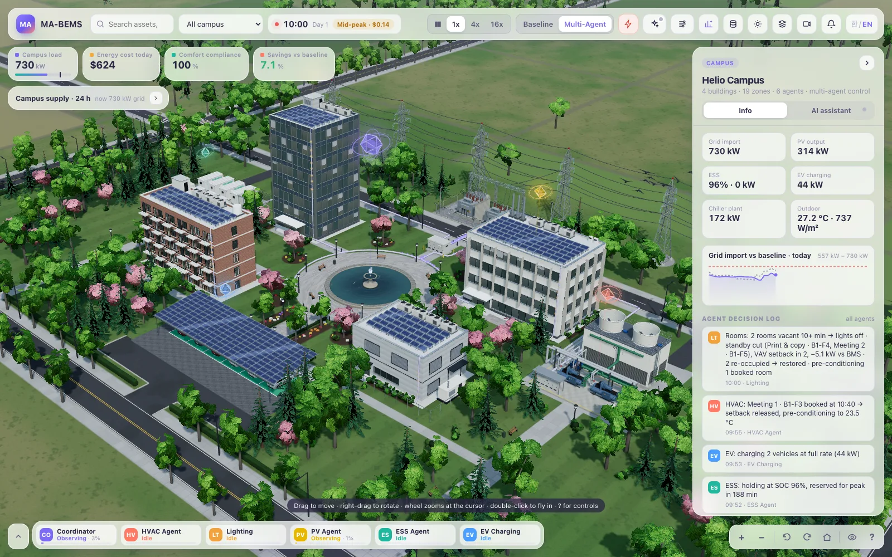

# MA-BEMS: Multi-Agent Building Energy Management

**Six cooperating agents run a simulated campus every 15 minutes, with a coordinator that settles conflicts by priority and cost, next to a rule-based BMS fed the same weather, occupancy and EV arrivals, so the difference in cost, peak demand and comfort can be measured directly. The numbers below are for coordinator v2, the default since 2026-11-12 (v1 is kept as `coord=v1`). A fine-tuned local LLM explains the agents' decisions and proposes control actions.**

English · [한국어](README.ko.md) · [Live dashboard](https://sunghyunc.github.io/ma-bems/) · [Evaluation](eval/README.md) · [Fine-tuning](ft/README.md)

Capstone design project at Korea University Sejong Campus, fall 2026, entered in the Industry-Linked Capstone Design Competition (results pending). It follows [Multi-Agent BEMS](https://github.com/SungHyunC/multi-agent-bems), the spring 2026 capstone that won the Excellence Award; the answer number check in `server/numcheck.py` was ported from that project.



**Demo video** (2:36, Korean narration and subtitles, 2026-11-12): [1080p](https://github.com/SungHyunC/ma-bems-project/releases/download/demo-2026-11-12/ma-bems-demo-ko.mp4) · [720p](https://github.com/SungHyunC/ma-bems-project/releases/download/demo-2026-11-12/ma-bems-demo-ko-720p.mp4). It was recorded by driving the live dashboard (coordinator v2). The AI answer in it was generated on the spot by the fine-tuned v2.2 model; for the recording, the same Q8_0 model file was served from a cloud GPU instead of the operator PC. A 10-page project overview (Korean) is in [docs/ma-bems-overview-ko.pdf](docs/ma-bems-overview-ko.pdf).

## Results

Counterfactual shadow run (IPMVP Option D style): the agents and a rule-based BMS run at the same time on identical inputs. Each setting runs 9 simulated days at 1-minute steps. Day 0 is warm-up, and days 1–8 are scored. Scripts and raw results are in [`eval/`](eval/README.md).

How to read the ±: in a single run the inputs are fixed, so "± 0.2" is the 95% t-interval over that run's 8 daily values, i.e. day-to-day variation only. The proper interval for "would it hold with different inputs" is the one across 10 seeded runs (`?seed=N` re-draws occupancy, EV sessions and DR timing and adds day-to-day weather), where each run counts once.

Coordinator v2 is the default. v1, the previous version, reproduces its old results exactly with `?coord=v1`; the v1 numbers are in brackets below and in "Coordinator history".

| Metric | Agents vs. rule-based BMS |
|---|---|
| Energy cost savings, default BMS | **17.4 ± 0.1%** [v1: 16.7%] (one run, ± = day-to-day variation of its 8 days). **16.9 ± 0.2%** [16.5%] over 10 seeds (95% CI across runs) |
| Tuned BMS (adds ESS peak control) | 17.3 ± 0.4% [16.6%]. It costs almost the same as the default BMS and its mean peak is slightly higher (1,176 vs. 1,170 kW), so it is not a stronger baseline in cost terms |
| Sensor BMS (the agents' occupancy sensing, ESS peak control and a fixed DR response) | **10.5 ± 0.3%** [9.7%] (10 seeds: 10.5 ± 0.2% [10.2%]). That BMS's comfort drops to 97.0% (10 seeds: 97.4%). With `dr=off` the saving vs. the default BMS is 15.0% [14.4%], so DR non-response explains about 2.4 points of the 17.4% |
| Peak demand | Mean of the daily maxima: 960 vs. 1,170 kW (maximum over the period: 960 vs. 1,210 kW; v1 had 959 and 960). 10 seeds: 969 vs. 1,193 kW [981]. Over 8 days: 0 vs. 1,996 minutes and 0 vs. 2,167 kWh above the 1,000 kW limit |
| Comfort compliance | 99.9% vs. 100% (10 seeds: 99.7 vs. 99.9%) |
| Grid-import forecast, 1 hour ahead, no future weather | CV(RMSE) 8.0%, NMBE −0.1% (n = 766 forecasts). Same-time-yesterday: 9.7%; one-hour persistence: 13.1% (v1 run: 9.0 and 14.1%). Over 10 seeds: 8.7 / 11.1 / 12.8%. ASHRAE Guideline 14's 30% is a calibration criterion for energy models, so it is a point of comparison here, not a forecasting standard the result is "within" |
| Sensor fault detection | 0 false alarms in 1,206 room-days of normal operation (default inputs). Over the 25 committed no-fault runs with default inputs: 6 in 30,150 room-days. With 0.3 °C sensor noise: 1 in 1,206, and the drill still catches 63 of 64 injected faults. The drill assumes an operator who knows which alarms are real. With weather variation (10 seeds) there were 33 false alarms in 12,060 room-days (13 of them in one seed; 34 and 14 under v1) |
| Demand charge (KEPCO 8,320 KRW per kW-month on the period maximum) | Not in the default cost. Adding it: KEPCO tariff on the modelled load 15.7 → 16.2%; BDG2 load shape 14.7 → 15.7%. There is no USD rate in the repository, so the dollar runs take it as a parameter |

BDG2 here is one measured summer weekday of non-HVAC electricity from four buildings of a US campus, rescaled to the Helio Campus and repeated every day. It is not measured load of this campus.

- **Ablations** show where the savings come from (percentage points, v2 default, v1 in brackets): room-level control 13.4 [12.3], ESS 3.6 [3.2], HVAC 2.5 [2.2], lighting 0.9 [0.7], EV 0.1 [0.0]. The coordinator's allocation step adds nothing on normal days (−0.16 [−0.15]); under v2, `ablate=COORD` removes only the cost-based allocation, while the forecast-aware battery and the DR pre-cool stay inside the agents' plans. Its value shows under tight limits. Over-limit energy with vs. without the coordinator: 900 kW 18 vs. 37 kWh (−52%), 850 kW 392 vs. 765 kWh (−49%), 800 kW 2,493 vs. 3,282 kWh (−24%). With v1 the same comparison gave 417 vs. 482, 1,675 vs. 2,129 and 4,610 vs. 5,083 kWh.
- **Coordinator history: v1 → v2.** v1 settled conflicting plans by priority. v2 is now the default (the user's decision on 2026-11-12) and adds a DR notice with a battery reserve and staged recovery after DR, forecast-aware ESS water-filling (the forecast uses no future data) and cost-based allocation between agents over up to 3 rounds. All 70 default-config runs were re-run; `coord=v1` reproduces the old results bit for bit (kept in `build/results/v1/`). v1 → v2: normal day 16.7 → 17.4% saving; over 10 seeds 16.5 → 16.9% (paired +0.4 ± 0.1 points) and period maximum −66 ± 26 kW; heat wave 13.7 → 15.4%; combined worst day 9.8 → 15.9% saving and mean peak 1,512 → 1,299 kW (now below the BMS's 1,454); 850 kW limit over-limit energy 1,675 → 392 kWh; 800 kW limit period maximum 1,157 → 950 kW. **Worse than v1:** minutes above the limit rise (heat wave 2,050 → 3,303, worst day 3,557 → 5,349, 800 kW limit 2,059 → 3,867); the saving at the 850 kW limit falls by 0.6 points; with the EV rush the mean daily maximum rises from 960 to 976 kW; DR delivery on the normal day falls from 142 to 139%; the fault-impact drill adds 1,605 instead of 1,572 kWh.
- **Nine scenarios** (normal day, heat wave, cloudy day, demand response, tighter limit, EV rush, holiday, stuck sensor, worst day) are reported separately. Cost savings (v1 in brackets where it differs notably): heat wave 15.4% [13.7], cloudy 14.3%, DR 19.1%, tight limit 17.3% [17.9], EV rush 17.9%, holiday 25.9%, worst day 15.9% [9.8]. On the combined worst day the mean daily peak is 1,299 kW against the BMS's 1,454 kW; under v1 it was *higher* than the BMS's (1,512 kW) because the battery ran out around 14:00 and cooling rebounded after the DR event. Details: [eval/README.md](eval/README.md).
- **Energy impact of sensor faults** (`?faultImpact=1`, 9 simulated days, an operator who approves real alarms): a drift fault adds 1,289 kWh with fault detection off and 26 kWh with it on; the every-3-hours fault drill adds 12,441 kWh with detection off (49 faults injected) vs. 1,605 kWh with it on (63 injected), so read it as a direction, not a like-for-like ratio. Limits: the virtual sensor has no feedback, so an unattended stuck sensor saves 406 kWh but adds 1,963 °C·h of discomfort; in the closed loop, drift detection slows from 55 to 245 minutes (median) and the drill raises 55 false alarms.

All results come from simulation. The savings have not been calibrated against metered data.

## How it works

```
Browser (GitHub Pages)                       Operator PC
index.html  ── AI tab ── HTTPS + access key ──> Cloudflare Quick Tunnel ──> LLM gateway (server/)
  simulation, 6 agents, forecast,                                           ├─ Qwen3-8B, fine-tuned (Ollama)
  fault detection, shadow BMS                                               └─ Claude (admin keys only)
```

- **Agents.** A coordinator plus HVAC, lighting, PV, ESS and EV-charging agents repeat observe → plan → coordinate → act → verify every 15 minutes over 4 buildings and 19 zones. The whole simulation runs in the browser in a single-file Three.js dashboard (`index.html`, assembled from `build/` by `build/inject.py`). Without URL options the committed results are reproduced bit for bit; the options below only add evaluation modes.
- **Forecast.** Grid import for the next 4 hours comes from a ridge regression on forecast weather (yesterday's profile plus today's offset), the occupancy timetable and lag features (same slot yesterday, last observed slot). It never reads actual future weather, and it is refitted every slot.
- **Dashboard additions.** A "Stage 1: building without room sensors" preset (`ablate=ROOM`) in the scenario tab. A proposal impact preview that replays a private copy of the simulator for the next 60 minutes with and without the action, behind a fidelity gate (works with both coordinators; not available with `faultImpact` or after a dataset was loaded mid-run). A shadow mode that takes a meter CSV, rescales it to campus size keeping its shape, prices it at KEPCO summer weekday rates and reports what the agents would have saved.
- **Evaluation URL options.** `baseline=sensor`, `dr=off`, `seed=N`, `coord=v1` (the previous coordinator; the default is v2), `drNotice`, `faultImpact=1`, `fddNoise`, `fdd=off`; see [eval/README.md](eval/README.md).
- **LLM gateway** (`server/`, Python standard library). It checks every number in an answer against the data it was given (`numcheck` binds each number to its label and rejects malformed numbers), routes typed questions (tariff lookups, glossary terms, direct commands, "will we exceed the limit?" from the forecast) away from the model when data can answer them, drops proposed actions that would change nothing, and guards against repetition. The prompt-extraction check covers every task, and a leak check runs before streamed text is sent. The public API needs an access key and has per-key rate limits and request-size limits; the local port checks Origin and Content-Type; `/v1/chat/completions` accepts admin keys only. `server/test_gateway.py` has 8 tests. The numcheck change leaves the pass rates on saved v2.1 outputs unchanged on every eval set; on the 66 real questions it newly flags 3 real errors, and one item could not be judged because its saved context differs.
- **Deployment.** The static site deploys from a separate Pages repository ([SungHyunC/ma-bems](https://github.com/SungHyunC/ma-bems)) after a CI check for script syntax, config format and secrets. The gateway stays on the operator PC behind a Cloudflare tunnel. See [deploy/README.md](deploy/README.md) (Korean).

## Local LLM fine-tuning

The public demo's AI assistant uses only a local model, so Qwen3-8B was fine-tuned with QLoRA (4-bit NF4 base, LoRA r=16, loss on answer tokens only). Training data comes from the simulator: scenario and random conditions were logged as the exact contexts the dashboard sends, and rule-based reference answers were written from those contexts. Paraphrased questions came from open models. No Claude output was used for training. Training ran on a 16 GB desktop GPU (v1) and a Modal H100 (v2.1, v2.2); evaluation used vLLM. The fine-tuned v2.2 was adopted on 2026-11-12 by the project owner's decision, replacing v2.1; the production desktop switches only when its Ollama model and `.env` are changed (steps in [ft/README.md](ft/README.md)).

| Held-out sets collected from the current default dashboard (coordinator v2) | Fine-tuned v2.1 | Fine-tuned v2.2 |
|---|---|---|
| Chat answers passing the number check (759 prompts) | 93.3% | **97.1%** |
| Stray numbers per chat answer | 1.45 | **0.38** |
| Proposed actions, precision / recall with values (127 prompts, model only) | 62.1 / 70.0% | **83.5 / 78.3%** |
| Says "nothing needs to change" when true (94 prompts, model only) | 9.6% | **87.2%** |
| Typed control requests, precision / recall with values (84 prompts, model only) | 49.8 / 55.6% | **65.7 / 62.2%** |
| 47 real-question items x 3 samples, check pass rate (excluding 6 old-snapshot items) | **92.7%** | 91.1% |
| Same, all items | **80.9%** | 79.4% |

The real-question pass rate is slightly lower for v2.2, mostly from one known limitation: asked "why is the battery discharging?", v2.2 reports the ESS agent's planned discharge (175 kW, from the decision log) as the current output, while the actual output was 228.7 kW after the minute peak guard. The gateway's number check flags that sentence, so in production the answer carries a warning. It is to be fixed in the next data iteration. v2.2 also relies on the context blocks the current dashboard sends; with older contexts it rarely proposes actions, so the public site must serve the current `index.html`.

Honesty notes: the 66 real questions are a regression set that the fixes were tuned on, and one item ("what are the agents doing now?") was in v1 training data, so it is not held out. The held-out sets use unseen simulator conditions and question sentences from the generator's evaluation split, not human-written questions.

The model still learns the rules' style rather than becoming smarter than the rules. The number check only tests whether a number appears in the data the model was given; it is not an accuracy measure, and none of these metrics tests whether the model understood the question. Details, including the v1 → v2 → v2.1 → v2.2 history: [ft/README.md](ft/README.md) (Korean). Trained adapters are in [Releases](https://github.com/SungHyunC/ma-bems-project/releases).

A follow-up test used 66 questions that judges and visitors are likely to type, across 15 categories. Without changing the model, routing, context and output guards raised the score from 41.5 to 62 out of 66 and cut wrong answers from 17 to 0 (Claude read and graded every answer; no person graded them). This is a regression set that the fixes were tuned on, so it shows that the known failures are fixed, not how the assistant does on new questions.

## Run locally (Windows)

```
python -m venv .venv && .venv\Scripts\pip install anthropic
copy .env.example .env              (fill in ANTHROPIC_API_KEY etc.; pull a Qwen3 8B model in Ollama)
.venv\Scripts\python server\mabems_server.py      → http://127.0.0.1:5178
```

To look around without the AI assistant, serve `index.html` from any static server; the simulation runs in the browser.

## Repository layout

| Path | Contents |
|---|---|
| `index.html` | The dashboard: simulation, agents, forecast and fault detection |
| `build/` | Dashboard modules, assembled into `index.html` by `build/inject.py`; evaluation harness |
| `server/` | Local server and LLM gateway: number check, question handling, public API |
| `eval/` | How to reproduce every reported number (including macOS notes), with result files |
| `ft/` | QLoRA fine-tuning: data generation, training, evaluation, results |
| `deploy/` | Public deployment scripts (GitHub Pages + Cloudflare tunnel, access keys) |
| `deck/` | Competition slide sources |
| `docs/` | Project overview (PDF and HTML, Korean) and the dashboard screenshot; the demo video is in Releases |
| `demo/` | Demo video toolchain: script, Korean TTS, automated recording, assembly |
| `data/` | Measured BDG2 sample (CC BY-SA 4.0) |
| [`HANDOFF.md`](HANDOFF.md) | Project status, decisions and command reference (Korean) |

Not in the repository: `.env` (API and access keys), Python environments, `cloudflared.exe`, the base Qwen3-8B weights, and merged models and GGUF files (tens of GB).

## Limitations

- Simulation only: no metered-data calibration and cooling season only. Demand charges are left out of the default cost (a separate calculation adds them).
- The energy impact of sensor faults is modelled only with `faultImpact=1`, with the limits described above. EV and PV metrics do not separate the controllers in these scenarios.
- The dashboard screenshot was made before these changes and may still show older wording and numbers (for example the 11.0% forecast figure and the v1-era 16.7% saving); so may the screenshots in the slide deck.
- The dashboard UI supports Korean and English. Most documentation outside this README is in Korean.
